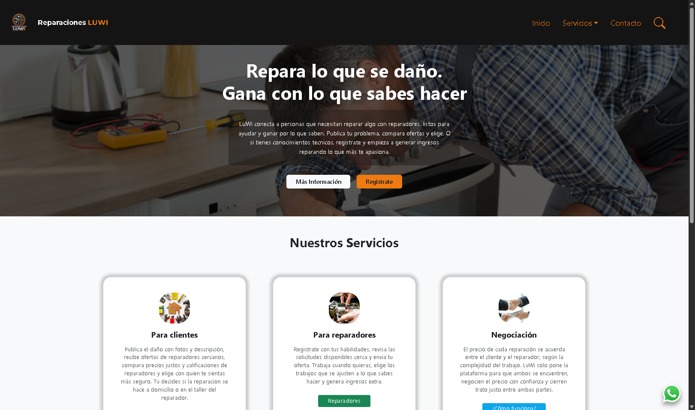
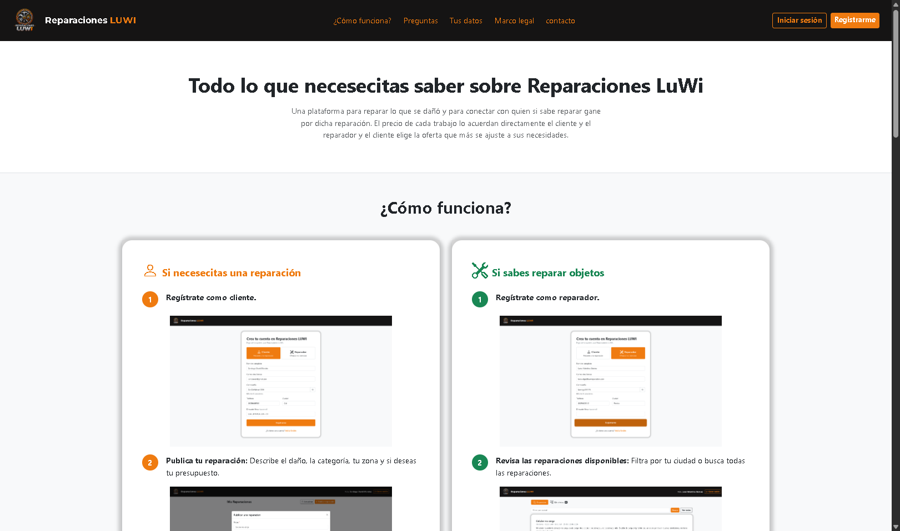
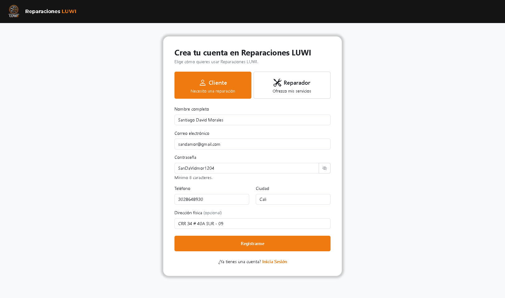
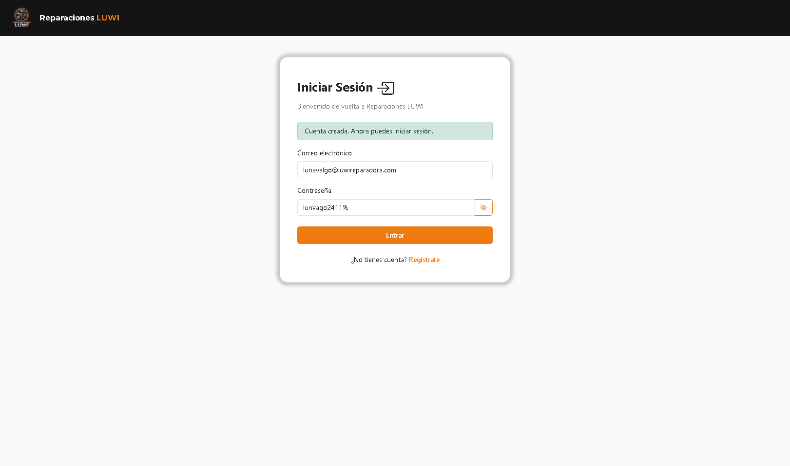
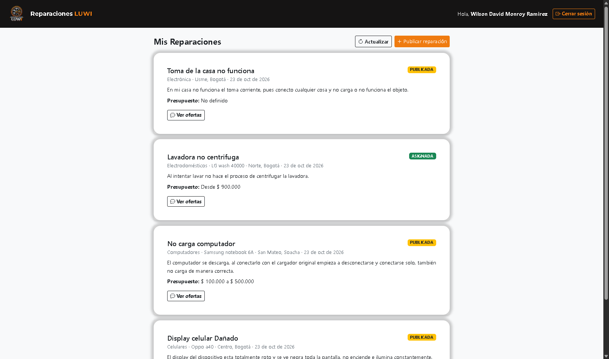
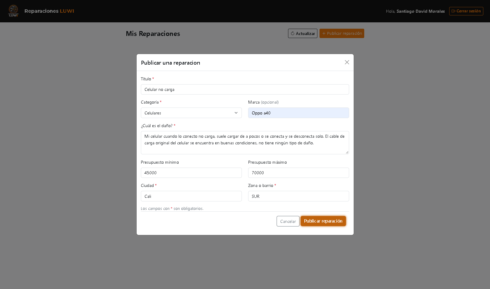
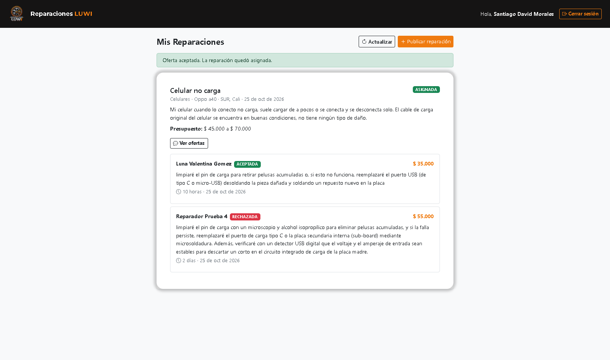
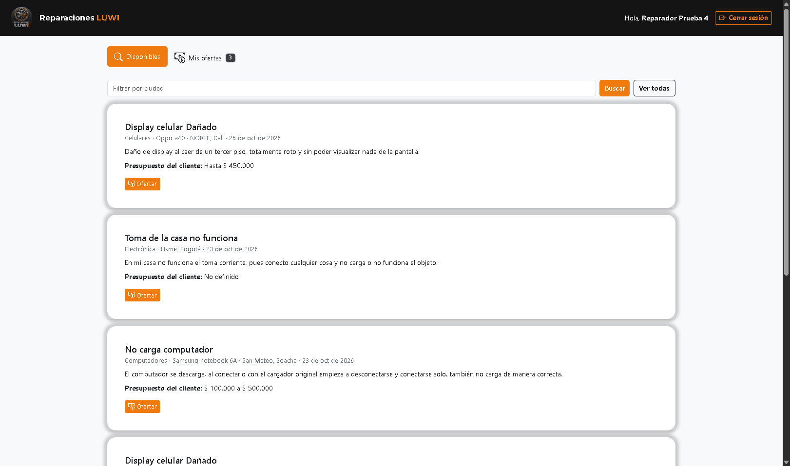
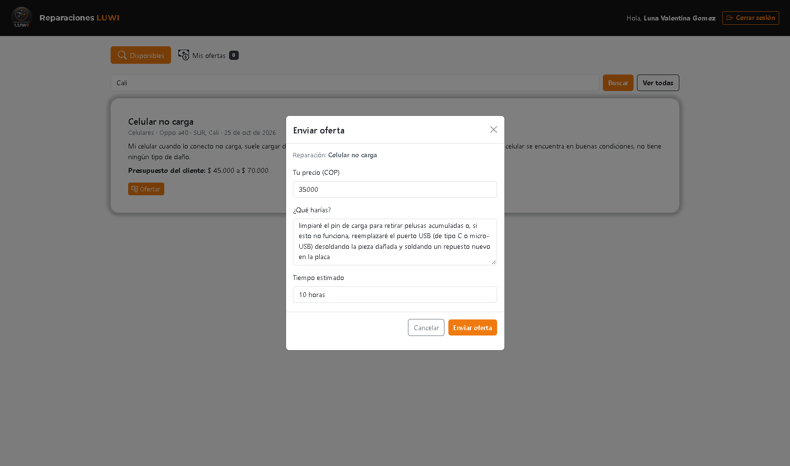
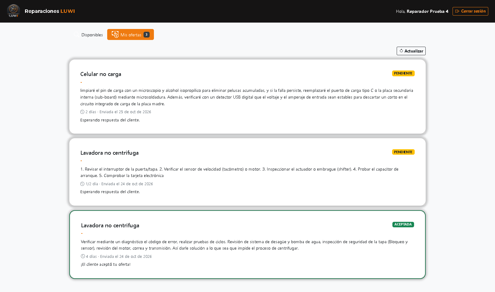

# LUWI Reparaciones

<table>
  <tr>
    <td width="150" align="center">
      
    </td>
    <td>
      Prototipo de plataforma donde clientes publican objetos dañados y reparadores envían ofertas de precio junto con explicación de lo que van a realizar.
    </td>
  </tr>
</table>

## Qué incluye
- Registro e inicio de sesión (JWT) con roles CLIENTE y REPARADOR.
- Panel de cliente: publicar reparaciones, ver ofertas, aceptar una oferta por reparación.
- Panel de reparador: ver reparaciones disponibles, filtrar o buscar por ciudad reparaciones disponibles, realizar una oferta por reparación, seguir ofertas realizadas.

## Tecnologías

### Backend
<table>
  <tr>
    <td align="center" width="140"><br><b style = "color: #ee1114">Java 25</b></td>
    <td align="center" width="140"><br><b style = "color: #6DB33F">Spring Boot 4.1.1</b></td>
    <td align="center" height="60"><br><b style = "color: #6DB33F;">Spring Security + JWT</b></td>
    <td align="center" width="140"><br><b style = "color: #59666C;">Spring Data JPA / Hibernate</b></td>
    <td align="center" width="140"><br><b style = "color: #C71A36;">Maven</b></td>
  </tr>
</table>

### Base de datos
<table>
  <tr>
    <td align="center" width="140"><br><b style = "color: #4479A1">MySQL 8.0</b></td>
  </tr>
</table>

### Frontend
<table>
  <tr>
    <td align="center" width="140"><br><b style = "color: #E34F26;">HTML5</b></td>
    <td align="center" width="140"><br><b style = "color: #1572B6;">CSS3</b></td>
    <td align="center" width="140"><br><b style = "color: #F7DF1E;">JavaScript</b></td>
    <td align="center" width="140"><br><b style = "color: #7952B3;">Bootstrap 5.3</b></td>
  </tr>
</table>

### Herramientas
<table>
  <tr>
    <td align="center" width="140"><br><b style = "color: #FFFFFF;">IntelliJ IDEA</b></td>
    <td align="center" width="140"><br><b style = "color: #007ACC;">VS Code</b></td>
    <td align="center" width="140"><br><b style = "color: #F05032;">Git</b></td>
    <td align="center" width="140"><br><b style = "color: #FFFFFF;">GitHub</b></td>
  </tr>
</table>


## Vista de la plataforma

### Inicio e información
<table>
  <tr>
    <td align="center"><br><sub>Página de inicio</sub></td>
    <td align="center"><br><sub>Más información</sub></td>
  </tr>
</table>

### Registro e inicio de sesión
<table>
  <tr>
    <td align="center"><br><sub>Registro</sub></td>
    <td align="center"><br><sub>Inicio de sesión</sub></td>
  </tr>
</table>

### Panel del cliente
<table>
  <tr>
    <td align="center"><br><sub>Mis reparaciones</sub></td>
    <td align="center"><br><sub>Publicar una reparación</sub></td>
  </tr>
  <tr>
    <td align="center" colspan="2"><br><sub>Ofertas recibidas y aceptar una</sub></td>
  </tr>
</table>

### Panel del reparador
<table>
  <tr>
    <td align="center"><br><sub>Reparaciones disponibles</sub></td>
    <td align="center"><br><sub>Enviar una oferta</sub></td>
  </tr>
  <tr>
    <td align="center" colspan="2"><br><sub>Seguimiento de mis ofertas</sub></td>
  </tr>
</table>

## Cómo ejecutarlo de manera local
1. Crear la base de datos `luwi_db` en MySQL Workbench v 8.0 de manera local. Entra a  MySQL Workbench v 8.0 e ingresa de manera local sin credenciales como local y en el puerto 3306, luego ejecuta el script de esta carpeta [script base de datos Reparaciones LUWI](reparacionesLuwi-backend/src/main/resources/ScriptSQLDataBase_Luwi.sql)
2. Definir la variable de entorno JWT_SECRET en IntelliJ IDEA. Abrir la carpeta en algun IDE como open folder o open project seleccionar la [carpeta de reparaciones LUWI backend](reparacionesluwi-backend/). Luego cargar todas las dependencias (debes tener Java 25 para poder hacer esto), luego en la barra superior de herramientas selecciona Run -> Edit Configurations... -> ReparacionesLuWiBackendApplication -> Modify options -> Enviroment variables debe estar seleccionado -> Edit Environment Variables -> add + -> name = JWT_SECRET -> value = "Lo que te de al ejecutar los siguientes comandos en powerShell".
```powershell
$b = New-Object byte[] 32; [Security.Cryptography.RandomNumberGenerator]::Create().GetBytes($b); [Convert]::ToBase64String($b)
```
3. Ejecutar el backend (http://localhost:8080), ejecutar el archivo [ReparacionesLUWIBackendApplication.java](reparacionesLuWi-backend/src/main/java/com/reparaciones_LuWi/backend/ReparacionesLUWIBackendApplication.java).
4. Abrir la carpeta del frontend con Live Server (puerto por defecto 5500) o Live Preview 3000, abrir [index.html](index.html) y listo puedes probar la plataforma a tu gusto.

## Endpoints principales

Todos los endpoints con rol requieren el encabezado `Authorization: Bearer <token>`,
que se obtiene en el login. Las respuestas de error tienen la forma `{"mensaje": "..."}`.

| Método | Ruta | Rol | Qué hace |
|---|---|---|---|
| POST | `/api/usuarios/registro` | Público | Registra un usuario (CLIENTE o REPARADOR) |
| POST | `/api/auth/login` | Público | Inicia sesión y devuelve el token JWT y los datos del usuario |
| GET | `/api/auth/me` | Cualquier usuario con sesión | Devuelve los datos del usuario del token |
| POST | `/api/reparaciones` | CLIENTE | Publica una reparación |
| GET | `/api/reparaciones/mis-reparaciones` | CLIENTE | Lista las reparaciones publicadas por el cliente |
| GET | `/api/reparaciones/disponibles?ciudad=` | REPARADOR | Lista las reparaciones disponibles; `ciudad` es opcional |
| POST | `/api/reparaciones/{id}/ofertas` | REPARADOR | Envía una oferta a una reparación |
| GET | `/api/reparaciones/{id}/ofertas` | CLIENTE | Lista las ofertas recibidas por una reparación |
| GET | `/api/ofertas/mis-ofertas` | REPARADOR | Lista las ofertas enviadas por el reparador |
| PUT | `/api/ofertas/{id}/aceptar` | CLIENTE | Acepta una oferta: las demás se rechazan y la reparación queda asignada |

### Cuerpos de las peticiones (JSON)

**Registro**: `nombre`, `correo`, `contrasena` (8 a 72 caracteres), `telefono`, `rol` (`CLIENTE` o `REPARADOR`), `ciudad` y, opcional, `direccionReferencia`.

**Login**: `correo`, `contrasena`.

**Crear reparación**: `titulo`, `descripcion`, `categoria`, `ciudad`, `zona` y, opcionales, `marcaObjeto`, `presupuestoMinimo`, `presupuestoMaximo`.

**Crear oferta**: `precioPropuesto`, `descripcion`, `tiempoEstimado`.

## Fuera del alcance de este prototipo o futuras mejoras
Fotos de evidencia del daño, calificaciones de reparadores, pagos en la propia plataforma, chat integrado, cancelar o finalizar reparaciones, entre otras cosas más como foto de usuario (clientes y reparadores), perfil entre otras modificaciones.

## Desarrolladores

<table>
  <tr>
    <td align="center" width="220">
        
        <br><b>Wilson David Monroy</b>
        <br><sub>Desarrollador</sub>
        <br><a href="https://github.com/wilda1308"></a>
    </td>
    <td align="center" width="220">
        
        <br><b>Luna Valentina Gomez</b>
        <br><sub>Desarrolladora</sub>
        <br><a href="https://github.com/Luna-Gomez"></a>
    </td>
  </tr>
</table>

<p align="center"><sub>LUWI Reparaciones · Prototipo académico · 2026</sub></p>
